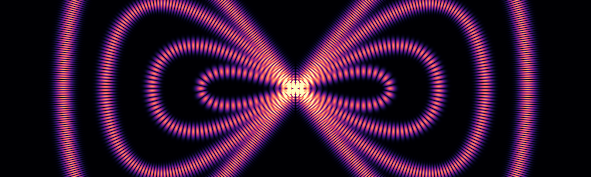

Research Fellow in Mathematics at University College London

Microlocal analysisSpectral theorySub-Riemannian geometryHarmonic analysis on groupsInverse problems

I am a Research Fellow in mathematics at University College London funded by EPSRC Early Career Fellowship: EP/V001760/1 (P.I. [Jeffrey Galkowski](https://www.homepages.ucl.ac.uk/~ucahalk/)).

I work in microlocal analysis and spectral theory, currently on quasimodes and eigenfunction concentration, and more broadly on geometric mechanics (sub-Riemannian geometry), harmonic analysis on groups, and inverse problems.

<figure class="home-banner">
  
</figure>

  <a class="home-area" href="/research/#strichartz">01Strichartz estimates and Fourier restriction</a>
  <a class="home-area" href="/research/#filtered">02Microlocal analysis on filtered manifolds</a>
  <a class="home-area" href="/research/#spectral">03Spectral asymptotics and eigenfunctions</a>
  <a class="home-area" href="/research/#inverse">04Integral geometry and inverse problems</a>

<h2 class="home-section">Background</h2>

  

    2024 &ndash; present
    

      <strong>Research Fellow</strong>, University College London 
      EPSRC Early Career Fellowship EP/V001760/1 (P.I. <a href="https://www.homepages.ucl.ac.uk/~ucahalk/">Jeffrey Galkowski</a>).
    

  

  

    Sep 2023 &ndash; Sep 2024
    

      <strong>Postdoctoral Researcher</strong>, Universit&agrave; di Padova 
      STARS Project &ldquo;New directions in sub-Riemannian geometry: submanifolds, curvature bounds, geometric hypoelliptic PDEs&rdquo; under <a href="https://www.math.unipd.it/~barilari/">Davide Barilari</a>. Member of the research group in <a href="https://www.math.unipd.it/~barilari/SRGPD.html">sub-Riemannian geometry in Padova</a>.
    

  

  

    Jan 2021 &ndash; Sep 2023
    

      <strong>Postdoctoral Research Associate</strong>, University of Bath 
      Member of the <a href="https://www.bath.ac.uk/teams/analysis-members/">Analysis Group</a>, supported by the Leverhulme Trust Research Project Grant RPG-2020-037 &ldquo;Quantum limits for sub-elliptic operators&rdquo; (PI <a href="https://www.veroniquefischer.com">V&eacute;ronique Fischer</a>, Co-PI <a href="https://perso.math.u-pem.fr/fermanian.clotilde/">Clotilde Fermanian-Kammerer</a>). Co-organised the <a href="https://bath-analysis.github.io/">Bath Analysis Seminar</a>.
    

  

  

    2020
    

      <strong>Ph.D. in Mathematics</strong>, University of California, Santa Cruz 
      Co-supervised by <a href="https://people.ucsc.edu/~rmont/">Richard Montgomery</a> and <a href="https://people.ucsc.edu/~fmonard/">Fran&ccedil;ois Monard</a>.
    

  

  

    Fall 2019
    

      <strong>Program Assistant</strong>, Mathematical Sciences Research Institute, Berkeley 
      Semester program in <a href="https://www.msri.org/programs/315">Microlocal Analysis</a>.
    

  

  

    2019
    

      <strong>Graduate Student Researcher</strong>, UC Santa Cruz 
      NSF grant &ldquo;<a href="https://www.nsf.gov/awardsearch/showAward?AWD_ID=1814104">Explicit methods for linear and non-linear tomography</a>&rdquo; (DMS-1814104, 2018&ndash;2020, PI Fran&ccedil;ois Monard).
    

  

