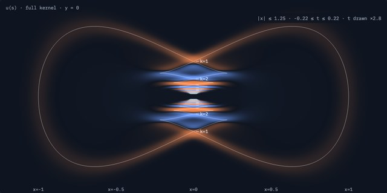
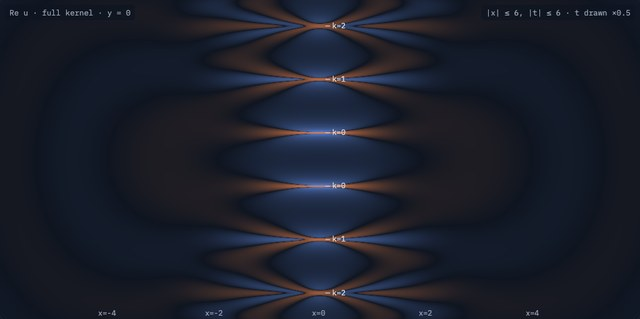

Graduate course, Taught Course Centre (TCC), online, Autumn 2026.

Interactive pages for the course. Each opens in a web browser.

<a href="/files/heisenberg/wave-kernel.html" style="flex:1 1 240px; max-width:320px;">Heisenberg Wave Kernel</a>
<a href="/files/heisenberg/schrodinger-kernel.html" style="flex:1 1 240px; max-width:320px;">Heisenberg Schrödinger Kernel</a>

The wave page is a 25 MB download.

These pages were made with AI assistance (Claude and Codex) and checked numerically. They have not been peer reviewed.
